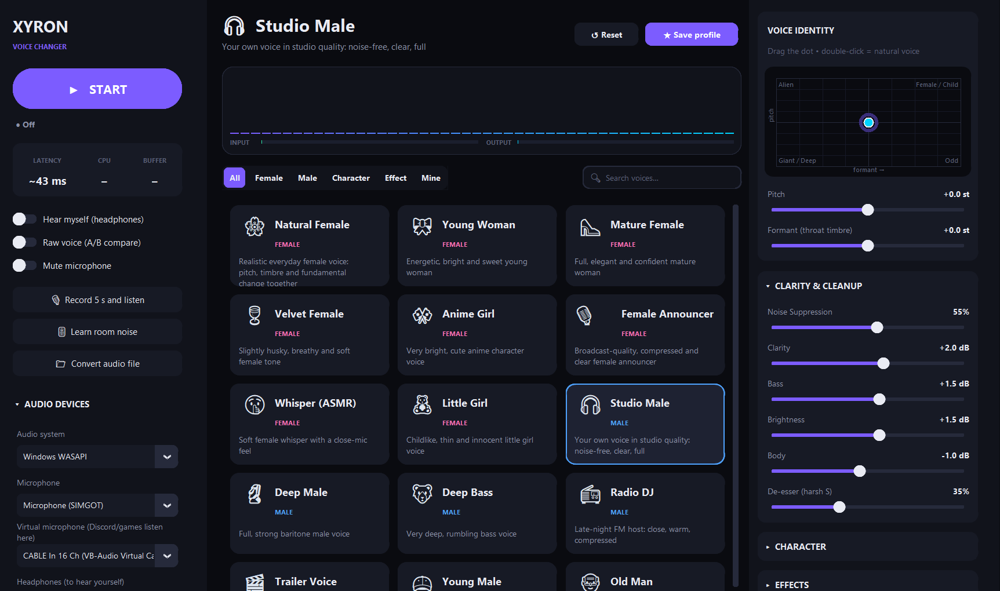
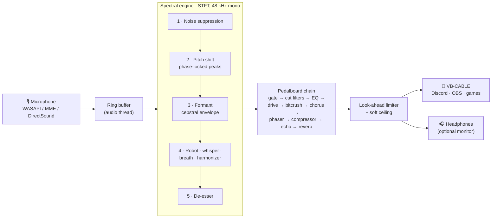

<div align="center">


# Xyron Voice Changer

**Become any voice. In real time.**

A free, open-source, studio-grade voice changer for Windows with formant-aware pitch shifting,
37 hand-tuned voices, 31 live controls and zero telemetry. Works with Discord, OBS, games and video calls.

[](https://github.com/Xyronb1/xyron-voice-changer/releases/latest)
[](https://github.com/Xyronb1/xyron-voice-changer/releases)


[](LICENSE)

[**🌐 Website & live audio demo**](https://Xyronb1.github.io/xyron-voice-changer/) ·
[**⬇️ Download**](https://github.com/Xyronb1/xyron-voice-changer/releases/latest) ·
[**🚀 Quick start**](#-quick-start) ·
[**🎭 Presets**](#-voice-presets) ·
[**❓ FAQ**](#-faq--troubleshooting)



</div>

---

## 📑 Table of contents

- [Why Xyron Voice Changer?](#-why-xyron-voice-changer)
- [Features](#-features)
- [Hear it](#-hear-it)
- [Quick start](#-quick-start)
- [Using it with Discord, OBS, games and calls](#-using-it-with-discord-obs-games-and-calls)
- [Voice presets](#-voice-presets)
- [Controls reference](#%EF%B8%8F-controls-reference)
- [Engine quality modes](#-engine-quality-modes)
- [Global hotkeys](#%EF%B8%8F-global-hotkeys)
- [Command-line interface](#-command-line-interface)
- [How it works](#-how-it-works)
- [Building from source](#%EF%B8%8F-building-from-source)
- [Settings and data](#-settings-and-data)
- [FAQ & troubleshooting](#-faq--troubleshooting)
- [Developers](#-developers)
- [Contributing](#-contributing)
- [Acknowledgements](#-acknowledgements)
- [License](#-license)

---

## 💡 Why Xyron Voice Changer?

Most voice changers simply speed up or slow down your voice, which is why they sound like chipmunks or
slow-motion monsters. Xyron Voice Changer treats your voice the way a vocal producer would. It
separates **pitch** (how high you speak) from **formant** (the resonances that tell the listener how big
your throat and head are), so you can:

- sound like a **natural woman**, not a sped-up man: pitch, formant *and* the fundamental tone change together;
- sound **deeper without the “muddy tape” effect**: a bigger throat, not just a lower note;
- design **characters** (robot, demon, ghost, alien) by layering a vocoder, harmonizer, whisper and effects on top.

Everything runs **locally and offline**. There is no account, no cloud processing and no telemetry; the
source contains no networking code at all.

## ✨ Features

| | |
|---|---|
| 🎚️ **Formant-aware pitch shifting** | Phase-locked Laroche–Dolson peak shifting plus a cepstral spectral envelope keep pitch and timbre independent. |
| 🎭 **37 built-in voices** | Female, Male, Character and Effect categories, plus unlimited user profiles in the **Mine** tab. |
| 🧹 **Studio cleanup** | Spectral noise suppression with *Learn room noise*, noise gate, de-esser, 4-band EQ, compressor, look-ahead limiter. |
| 🕹️ **XY voice pad** | Drag one dot to move pitch and formant together; double-click to return to your natural voice. |
| 🤖 **Character & FX rack** | Robot vocoder, whisper, breath, vibrato, octave harmonizer, distortion, bitcrush, chorus, phaser, echo, reverb. |
| ⌨️ **Global hotkeys** | Raw-voice A/B, mute and on/off that work while a full-screen game has focus. |
| 🎧 **Hear what others hear** | *Record 5 s and listen*, live *Hear myself* monitoring and click-free *Raw voice* comparison. |
| 📁 **Offline file conversion** | WAV, MP3, FLAC, OGG, M4A, AIFF → 24-bit WAV, from the app or the CLI. |
| 📊 **Live telemetry** | Latency, CPU load, buffer health, input/output meters and a real-time spectrum. |
| 🛟 **Self-healing audio** | Adaptive ±0.5 % micro-resampling absorbs clock drift; a watchdog reconnects dropped devices. |
| 🌍 **English & Turkish** | Full UI, presets and CLI translations; follows your Windows display language on first launch. |
| 🔒 **Private by design** | 100 % offline. Your voice never leaves your computer. |

## 🔊 Hear it

The [project website](https://Xyronb1.github.io/xyron-voice-changer/#demo) has an interactive player with the same
sentence rendered through 11 presets by the app's own engine. You can also download the clips directly:

| Original | Natural Female | Deep Male | Trailer Voice | Robot | Demon |
|:---:|:---:|:---:|:---:|:---:|:---:|
| [▶ original.mp3](docs/assets/audio/original.mp3) | [▶ f_natural.mp3](docs/assets/audio/f_natural.mp3) | [▶ m_deep.mp3](docs/assets/audio/m_deep.mp3) | [▶ m_trailer.mp3](docs/assets/audio/m_trailer.mp3) | [▶ c_robot.mp3](docs/assets/audio/c_robot.mp3) | [▶ c_demon.mp3](docs/assets/audio/c_demon.mp3) |
| **Chipmunk** | **Ghost** | **Anonymous Hacker** | **Telephone** | **Walkie-Talkie** | **Studio Male** |
| [▶ c_chipmunk.mp3](docs/assets/audio/c_chipmunk.mp3) | [▶ c_ghost.mp3](docs/assets/audio/c_ghost.mp3) | [▶ c_hacker.mp3](docs/assets/audio/c_hacker.mp3) | [▶ e_phone.mp3](docs/assets/audio/e_phone.mp3) | [▶ e_radio.mp3](docs/assets/audio/e_radio.mp3) | [▶ m_clean.mp3](docs/assets/audio/m_clean.mp3) |

<sub>Source: a synthetic male speech sample, Studio Quality mode, presets applied with no manual tweaking.</sub>

## 🚀 Quick start

### Requirements

| | |
|---|---|
| **OS** | Windows 10 or 11, 64-bit |
| **Audio** | Any microphone; headphones recommended for self-monitoring |
| **Virtual cable** | [VB-CABLE](https://vb-audio.com/Cable/) (free donationware), needed to feed Discord, OBS, games… |
| **CPU** | Any modern dual-core; use *Balanced* mode on older machines |

### 1 · Install the virtual microphone (one time)

1. Download VB-CABLE from the [official website](https://vb-audio.com/Cable/), or the unmodified
   `VBCABLE_Driver_Pack.zip` attached to the [latest release](https://github.com/Xyronb1/xyron-voice-changer/releases/latest).
2. Extract it, right-click **`VBCABLE_Setup_x64.exe` → Run as administrator → Install Driver**.
3. **Restart your PC.**

> [!TIP]
> Extract the pack into a folder named `VBCable` next to the EXE and the in-app
> **“⚠ VB-Cable not found: Install”** button will launch the installer for you.

### 2 · Download and run

| File | Description |
|---|---|
| [`Xyron-Voice-Changer-win64.exe`](https://github.com/Xyronb1/xyron-voice-changer/releases/latest/download/Xyron-Voice-Changer-win64.exe) | Single portable executable. Double-click to run, nothing to install. |
| [`Xyron-Voice-Changer-win64-portable.zip`](https://github.com/Xyronb1/xyron-voice-changer/releases/latest/download/Xyron-Voice-Changer-win64-portable.zip) | Folder build: starts faster and triggers fewer antivirus false positives. Extract and run `Xyron Voice Changer.exe`. |
| `SHA256SUMS.txt` | Checksums to verify your download. |

> [!NOTE]
> The executable is not code-signed yet. If **Windows SmartScreen** appears, click **More info → Run anyway**.
> If your antivirus reports **“Access denied”**, add the EXE (or its folder) to its exclusions, use the
> portable folder build, or [run from source](#%EF%B8%8F-building-from-source).

### 3 · First launch

1. In the left sidebar under **Audio devices**, choose:

   | Setting | Value |
   |---|---|
   | Audio system | `Windows WASAPI` (recommended; try `MME` if you hear crackles) |
   | Microphone | your real microphone |
   | Virtual microphone | `CABLE Input (VB-Audio Virtual Cable)` |
   | Headphones | optional, to hear yourself |

2. Press **▶ START**.
3. Click **🎚 Learn room noise** and stay silent for 2–3 seconds.
4. Click a voice card. Use **🎙 Record 5 s and listen** to hear exactly what others will hear.
5. Like what you made? **★ Save profile** stores it in the **Mine** tab.

## 🎮 Using it with Discord, OBS, games and calls

In every app the rule is the same: **use `CABLE Output (VB-Audio Virtual Cable)` as the microphone.**

<details>
<summary><b>Discord</b></summary>

1. **User Settings → Voice & Video → Input Device** → `CABLE Output (VB-Audio Virtual Cable)`.
2. Turn **off** *Noise Suppression (Krisp)* and *Echo Cancellation*: Xyron already cleans your voice,
   and Krisp can mangle shifted voices.
3. Keep using Push-to-Talk or voice activity as usual.
</details>

<details>
<summary><b>OBS Studio</b></summary>

1. **Sources → + → Audio Input Capture** → Device: `CABLE Output (VB-Audio Virtual Cable)`.
2. Mute or remove your original *Mic/Aux* source so viewers don't hear both voices.
3. Toggle between your real and changed voice live with <kbd>Ctrl</kbd>+<kbd>Alt</kbd>+<kbd>B</kbd>.
</details>

<details>
<summary><b>Games</b></summary>

1. In the game's audio / voice-chat settings, set the microphone to `CABLE Output`.
2. No device selector? Set `CABLE Output` as the **default input device** in Windows *Sound settings*.
3. Global hotkeys keep working while the game is full-screen.
</details>

<details>
<summary><b>Zoom, Microsoft Teams, Google Meet</b></summary>

1. **Settings → Audio → Microphone** → `CABLE Output (VB-Audio Virtual Cable)`.
2. Disable the app's own aggressive noise suppression for the cleanest sound.
3. For work calls try **Studio Male** (`m_clean`): your own voice, just cleaner and fuller.
</details>

## 🎭 Voice presets

Values are tuned for a typical adult male speaking voice (~100–140 Hz). If your voice is higher, start
from **Female to Male** or nudge the XY pad. *Pitch* and *formant* are in semitones (12 st = one octave).

| | Voice | Category | Pitch | Formant | Description | CLI key |
|---|---|---|---:|---:|---|---|
| 🌸 | **Natural Female** | Female | +10.0 st | +3.2 st | Realistic everyday female voice: pitch, timbre and fundamental change together | `f_natural` |
| 🎀 | **Young Woman** | Female | +11.5 st | +3.8 st | Energetic, bright and sweet young woman | `f_young` |
| 👠 | **Mature Female** | Female | +8.5 st | +2.6 st | Full, elegant and confident mature woman | `f_mature` |
| 🍷 | **Velvet Female** | Female | +8.5 st | +2.8 st | Slightly husky, breathy and soft female tone | `f_velvet` |
| 🎌 | **Anime Girl** | Female | +12.0 st | +5.0 st | Very bright, cute anime character voice | `f_anime` |
| 🎙️ | **Female Announcer** | Female | +9.5 st | +3.0 st | Broadcast-quality, compressed and clear female announcer | `f_announcer` |
| 🤫 | **Whisper (ASMR)** | Female | +8.0 st | +3.0 st | Soft female whisper with a close-mic feel | `f_whisper` |
| 🧸 | **Little Girl** | Female | +12.0 st | +6.0 st | Childlike, thin and innocent little girl voice | `f_girl` |
| 🎧 | **Studio Male** | Male | +0.0 st | +0.0 st | Your own voice in studio quality: noise-free, clear, full | `m_clean` |
| 🗿 | **Deep Male** | Male | -3.0 st | -1.5 st | Full, strong baritone male voice | `m_deep` |
| 🐻 | **Deep Bass** | Male | -5.0 st | -2.6 st | Very deep, rumbling bass voice | `m_bass` |
| 📻 | **Radio DJ** | Male | -1.5 st | -0.8 st | Late-night FM host: close, warm, compressed | `m_radio` |
| 🎬 | **Trailer Voice** | Male | -6.0 st | -3.0 st | Huge and cinematic, like a movie trailer narrator | `m_trailer` |
| 🧢 | **Young Male** | Male | +2.5 st | +1.0 st | A younger, energetic lad | `m_young` |
| 👴 | **Old Man** | Male | -1.5 st | -0.8 st | Shaky, breathy and tired old man | `m_old` |
| 🔁 | **Female to Male** | Male | -6.5 st | -2.6 st | Turns a female voice into a convincing male voice | `m_from_female` |
| 🤖 | **Robot** | Character | +0.0 st | +0.0 st | Classic metallic, single-pitch robot | `c_robot` |
| 💠 | **AI Assistant** | Character | +3.0 st | +1.5 st | Calm and flawless AI assistant | `c_ai` |
| 🦾 | **Cyborg** | Character | -2.0 st | -1.0 st | Half human, half machine: harsh and digital | `c_cyborg` |
| 😈 | **Demon** | Character | -6.0 st | -3.5 st | Layered an octave down: muffled and frightening demon | `c_demon` |
| 🏔️ | **Giant** | Character | -8.0 st | -4.5 st | A huge creature living in a cave | `c_giant` |
| 👹 | **Monster** | Character | -5.0 st | -1.0 st | Growling, savage orc/monster voice | `c_monster` |
| 🌑 | **Dark Lord** | Character | -4.0 st | -2.0 st | Masked, metallic and commanding villain | `c_dark_lord` |
| 👽 | **Alien** | Character | +3.0 st | -2.5 st | Wavering alien voice with mismatched formants | `c_alien` |
| 👻 | **Ghost** | Character | +2.0 st | +0.5 st | Whispery, distant and eerie ghost | `c_ghost` |
| 🐿️ | **Chipmunk** | Character | +10.0 st | +10.0 st | Funny helium-like chipmunk voice | `c_chipmunk` |
| 🧒 | **Child** | Character | +8.0 st | +4.5 st | A school-age child's voice | `c_child` |
| 🕶️ | **Anonymous Hacker** | Character | -4.0 st | -2.0 st | Identity-masked anonymous voice with digital distortion | `c_hacker` |
| 📺 | **Static Deep Voice** | Character | -5.0 st | -2.5 st | Like an identity-protected interview: staticky and deep | `c_static_deep` |
| ☎️ | **Telephone** | Effect | +0.0 st | +0.0 st | An old landline phone call | `e_phone` |
| 📡 | **Walkie-Talkie** | Effect | +0.0 st | +0.0 st | Tactical military radio: crackly and squeezed | `e_radio` |
| 📢 | **Megaphone** | Effect | +0.0 st | +0.0 st | Street megaphone: harsh and loud | `e_megaphone` |
| 🕳️ | **Cave** | Effect | +0.0 st | +0.0 st | Echo bouncing off stone walls | `e_cave` |
| 🏛️ | **Concert Hall** | Effect | +0.0 st | +0.0 st | Speaking in a large hall: wide and grand | `e_hall` |
| 🌊 | **Underwater** | Effect | +0.0 st | +0.0 st | A muffled voice from under the water | `e_underwater` |
| 🎶 | **Choir** | Effect | +0.0 st | +0.0 st | A crowded choir with an octave layer behind | `e_choir` |
| 📼 | **Old Radio** | Effect | +0.0 st | +0.0 st | A 1940s radio broadcast | `e_old_radio` |

## 🎛️ Controls reference

All 31 parameters change in real time while you speak.

| Section | Control | Range | Default | What it does |
|---|---|---|---|---|
| Voice Identity | **Pitch** | -12.0 st … +12.0 st | +0.0 st | How high or low you speak; shifts the voice without changing speed |
| Voice Identity | **Formant (throat timbre)** | -12.0 st … +12.0 st | +0.0 st | Perceived throat/head size: up = smaller, more feminine or childlike; down = bigger |
| Clarity & Cleanup | **Noise Suppression** | 0% … 100% | 35% | Spectral noise suppression (fans, hum, hiss); pair with *Learn room noise* |
| Clarity & Cleanup | **De-esser (harsh S)** | 0% … 100% | 25% | Tames harsh “s”/“sh” sounds |
| Clarity & Cleanup | **Bass** | -12 dB … +12 dB | +0 dB | Low shelf at 160 Hz: warmth and weight |
| Clarity & Cleanup | **Body** | -12 dB … +12 dB | +0 dB | Peak at 350 Hz: fullness vs. boxiness |
| Clarity & Cleanup | **Clarity** | -12 dB … +12 dB | +0 dB | Peak at 3.2 kHz: intelligibility |
| Clarity & Cleanup | **Brightness** | -12 dB … +12 dB | +0 dB | High shelf at 9 kHz: sparkle |
| Character | **Robot** | 0% … 100% | 0% | Fixed-pitch vocoder blend for a robotic voice |
| Character | **Robot Pitch** | 50 Hz … 300 Hz | 110 Hz | The note the robot voice sings on |
| Character | **Whisper** | 0% … 100% | 0% | Replaces the voiced tone with breathy noise |
| Character | **Breath / Air** | 0% … 100% | 0% | Adds air and breathiness |
| Character | **Vibrato** | +0.0 st … +1.5 st | +0.0 st | Depth of a periodic pitch wobble |
| Character | **Vibrato Rate** | 1 Hz … 12 Hz | 5.5 Hz | Speed of the vibrato |
| Character | **Layer Pitch** | -24.0 st … +24.0 st | -12.0 st | Interval of the harmonizer voice (−12 = an octave below) |
| Character | **Layer (harmonizer)** | 0% … 100% | 0% | Level of the harmonizer voice (demons, choirs, aliens) |
| Character | **Fundamental (softness)** | +0 dB … +12 dB | +0 dB | Boosts the fundamental for a softer, rounder tone; key to natural female voices |
| Effects | **Distortion** | +0 dB … +30 dB | +0 dB | Distortion (level auto-compensated) |
| Effects | **Bitcrush (0=off)** | 0 bit … 16 bit | 0 bit | Bit-depth reduction for lo-fi digital grit; 0 = off |
| Effects | **Chorus** | 0% … 100% | 0% | Thickens the voice with modulated copies |
| Effects | **Phaser** | 0% … 100% | 0% | Sweeping phase effect |
| Effects | **Echo** | 0% … 100% | 0% | Echo level |
| Effects | **Echo Time** | 20 ms … 1000 ms | 250 ms | Time between echoes |
| Effects | **Echo Feedback** | 0% … 90% | 30% | How many times the echo repeats |
| Effects | **Reverb (room)** | 0% … 100% | 0% | Room reverb level |
| Effects | **Room Size** | 0% … 100% | 40% | Size of the simulated room |
| Output & Dynamics | **Noise Gate** | -90 dB … -20 dB | -70 dB | Silences everything below this level between words (leftmost = off) |
| Output & Dynamics | **Low Cut** | 20 Hz … 1 kHz | 80 Hz | Removes rumble below this frequency |
| Output & Dynamics | **High Cut** | 1 kHz … 20 kHz | 20 kHz | Removes highs above this frequency (telephone, underwater); rightmost = off |
| Output & Dynamics | **Compressor** | 0% … 100% | 45% | Evens out loud and quiet parts; automatic make-up gain |
| Output & Dynamics | **Output Level** | -24 dB … +12 dB | +0 dB | Final output level before the limiter |

## ⚡ Engine quality modes

Select in **Audio devices → Engine quality**. Engine latency is the STFT window length; your sound card
adds a few milliseconds on top.

| Mode | CLI key | FFT / hop | Engine latency | Best for |
|---|---|---|---|---|
| **Maximum Clarity** | `max` | 4096 / 512 | ≈ 85 ms | Deep voices that sound grainy when shifted |
| **Studio Quality** *(default)* | `studio` | 2048 / 256 | ≈ 43 ms | Everyday use, streaming, voice chat |
| **Balanced** | `balanced` | 2048 / 512 | ≈ 43 ms | Older CPUs (half the processing) |
| **Low Latency** | `low_latency` | 1024 / 256 | ≈ 21 ms | Competitive games, singing along |

## ⌨️ Global hotkeys

| Shortcut | Action |
|---|---|
| <kbd>Ctrl</kbd> + <kbd>Alt</kbd> + <kbd>B</kbd> | **Raw voice**: bypass the changer instantly (click-free crossfade) |
| <kbd>Ctrl</kbd> + <kbd>Alt</kbd> + <kbd>M</kbd> | **Mute** the microphone |
| <kbd>Ctrl</kbd> + <kbd>Alt</kbd> + <kbd>V</kbd> | **Start / stop** the voice changer |

Hotkeys are registered system-wide with the Win32 `RegisterHotKey` API. If another program already owns a
combination, the app tells you on start-up. Disable them with `"hotkey_enabled": false` in `settings.json`.

## 💻 Command-line interface

Without arguments `main.py` opens the app. With arguments it works as a CLI for batch conversion and diagnostics.

```text
usage: xyron-voice [-h] [--list-presets] [--list-devices]
                   [--render INPUT OUTPUT] [--preset PRESET] [--pitch PITCH]
                   [--formant FORMANT]
                   [--quality {max,studio,balanced,low_latency}]
                   [--lang {tr,en}] [--version] [--debug]
```

| Option | Description |
|---|---|
| `--list-presets` | List the built-in and saved voice presets |
| `--list-devices` | List audio devices grouped by audio system, with suggested picks |
| `--render INPUT OUTPUT` | Process an audio file (WAV/MP3/FLAC/OGG/M4A/AIFF) and save a 24-bit, 48 kHz WAV |
| `--preset KEY` | Preset key, see the table above (default `m_clean`) |
| `--pitch N` / `--formant N` | Override pitch / formant in semitones (−12 … +12) |
| `--quality MODE` | `max`, `studio` (default), `balanced`, `low_latency` |
| `--lang tr\|en` | Language for CLI output and the app window (default: saved setting, else system language) |
| `--version` | Print the version |
| `--debug` | Show the full traceback instead of a friendly error |

**Exit codes:** `0` success · `1` runtime error · `2` usage error (missing input file, unknown preset, bad argument).

### Examples

```powershell
# List every preset in English
python main.py --list-presets --lang en
```

```text
f_natural        Female    Natural Female       pitch=+10.0 formant=+3.2  Realistic everyday female voice: ...
m_deep           Male      Deep Male            pitch=-3.0 formant=-1.5  Full, strong baritone male voice
c_robot          Character Robot                pitch=+0.0 formant=+0.0  Classic metallic, single-pitch robot
e_radio          Effect    Walkie-Talkie        pitch=+0.0 formant=+0.0  Tactical military radio: crackly and squeezed
```

```powershell
# Find your devices
python main.py --list-devices
```

```text
== Windows WASAPI
  IN  [12] Microphone (USB Audio)  <- suggested microphone
  OUT [ 9] CABLE Input (VB-Audio Virtual Cable)  <- virtual cable
  OUT [ 7] Headphones (Realtek Audio)  <- headphones
```

```powershell
# Turn a narration into a movie-trailer voice
python main.py --render narration.mp3 narration_trailer.wav --preset m_trailer

# Custom voice: 5 semitones higher, throat 2 semitones smaller, best quality
python main.py --render in.wav out.wav --pitch 5 --formant 2 --quality max

# Batch-convert a whole folder with PowerShell
Get-ChildItem .\voice-lines\*.wav | ForEach-Object {
    python main.py --render $_.FullName ".\out\$($_.BaseName)_robot.wav" --preset c_robot
}
```

## 🔬 How it works



- **Spectral engine (`dsp.py`).** Each STFT frame is denoised against a minimum-tracked noise floor,
  pitch-shifted with Laroche–Dolson peak-region shifting (phase-locked, so less “phasiness”), then
  re-shaped with a cepstral envelope so that formant and pitch move independently. Character layers
  (fixed-pitch vocoder, whisper, breath, harmonizer) and a de-esser run in the same frame.
- **Effect chain (`effects.py`).** Built on Spotify's [Pedalboard](https://github.com/spotify/pedalboard).
  Effects exist only while switched on, and the chain is rebuilt only when its *structure* changes, so
  reverb and echo tails keep ringing while you drag sliders.
- **Safety.** A look-ahead peak limiter (−1 dBFS) plus a `tanh` soft ceiling guarantee the output never clips;
  bypass and mute use short ramps so toggling never clicks.
- **Real-time I/O (`audio_io.py`).** Input, processing and each output run decoupled through thread-safe
  ring buffers. An adaptive reader nudges playback speed by up to ±0.5 % to absorb clock drift between
  different sound cards without audible artefacts, and a watchdog reconnects lost devices.
- **Interface (`ui.py`).** CustomTkinter. The UI thread only swaps parameter snapshots; it never touches audio.

### Project layout

```text
main.py                 entry point: GUI + CLI
xyrox_voice/
├── dsp.py              STFT voice engine: denoise, pitch, formant, character layers, de-esser
├── effects.py          Pedalboard effect chain + look-ahead peak limiter
├── processor.py        engine + effects + meters; quality modes; soft ceiling
├── audio_io.py         device discovery, ring buffers, adaptive reader, real-time router
├── ui.py               CustomTkinter interface
├── presets.py          37 built-in presets + user preset store (JSON)
├── params.py           single source of truth for every parameter, range and unit
├── i18n.py             English / Turkish translations, system-language detection
├── hotkeys.py          global Windows hotkeys via ctypes (no extra dependency)
├── render.py           offline file rendering
└── config.py           settings.json + migration from older versions
tests/                  pytest suite (113 tests)
docs/                   project website (GitHub Pages)
Xyron_Voice_Changer.spec          PyInstaller: single-file EXE
Xyron_Voice_Changer_onedir.spec   PyInstaller: portable folder build
```

## 🛠️ Building from source

Requires [Python 3.12+](https://www.python.org/downloads/) on Windows.

```powershell
git clone https://github.com/Xyronb1/xyron-voice-changer.git
cd xyron-voice-changer
python -m venv .venv
.venv\Scripts\python.exe -m pip install -r requirements.txt

# run the app
.venv\Scripts\python.exe main.py
```

### Run the tests

```powershell
.venv\Scripts\python.exe -m pip install pytest
.venv\Scripts\python.exe -m pytest
```

The suite covers the DSP engine (pitch accuracy, formant independence, latency), effects and limiter,
ring buffers and drift compensation, presets and the preset store, CLI behaviour and exit codes, settings
migration and translation completeness. Tests never touch your real `%APPDATA%`.

### Build the executables

```powershell
.venv\Scripts\python.exe -m pip install pyinstaller

# single portable file  ->  dist\Xyron Voice Changer.exe
.venv\Scripts\python.exe -m PyInstaller --noconfirm --clean Xyron_Voice_Changer.spec

# portable folder build ->  dist\Xyron Voice Changer\
.venv\Scripts\python.exe -m PyInstaller --noconfirm --clean Xyron_Voice_Changer_onedir.spec
```

### Dependencies

| Package | Purpose |
|---|---|
| [numpy](https://numpy.org/) | DSP math and FFTs |
| [sounddevice](https://python-sounddevice.readthedocs.io/) | Real-time audio streams (PortAudio) |
| [pedalboard](https://github.com/spotify/pedalboard) | Studio effects and audio-file I/O |
| [customtkinter](https://github.com/TomSchimansky/CustomTkinter) | Modern dark UI |
| [pillow](https://python-pillow.org/) | Icons and images |

## 📂 Settings and data

| Path | Contents |
|---|---|
| `%APPDATA%\Xyron_Voice_Changer\settings.json` | Devices, engine quality, language, last preset, hotkey toggle |
| `%APPDATA%\Xyron_Voice_Changer\presets.json` | Your saved profiles (**Mine** tab) |

Delete the folder to reset everything. Settings from older *XYROX Voice Studio* builds
(`%APPDATA%\XYROX_Voice_Studio`) are copied over automatically on first launch; the old folder is left untouched.

<details>
<summary>Example <code>settings.json</code></summary>

```json
{
  "hostapi": "Windows WASAPI",
  "mic": "Microphone (USB Audio)",
  "cable": "CABLE Input (VB-Audio Virtual Cable)",
  "monitor": "Headphones (Realtek Audio)",
  "monitor_on": false,
  "quality": "studio",
  "preset": "f_natural",
  "params": {},
  "hotkey_enabled": true,
  "language": "en"
}
```
</details>

### Adding a language

1. Add the language code to `LANGUAGES` in [`xyrox_voice/i18n.py`](xyrox_voice/i18n.py).
2. Add a dictionary for it to `TRANSLATIONS` (copy `EN` as a starting point).
3. Run `python -m pytest tests/test_i18n.py`: it lists every string that is still missing.

Untranslated strings fall back gracefully, so the app never crashes because of a missing translation.

## ❓ FAQ & troubleshooting

<details>
<summary><b>My friends can't hear my changed voice.</b></summary>

Check the chain end to end: in Xyron the *Virtual microphone* must be `CABLE Input` and the app must be
running (**● Active**). In Discord or your game, the input device must be `CABLE Output`. If VB-CABLE
appears nowhere, reinstall it as administrator and reboot.
</details>

<details>
<summary><b>I hear crackling or dropouts.</b></summary>

- Switch *Audio system* to `MME` or `Windows DirectSound`.
- Use *Engine quality → Balanced* to halve the CPU load.
- Close other apps that may hold the microphone in *exclusive mode*.
- Watch the **BUFFER** indicator (*Good / Fair / Poor*).
</details>

<details>
<summary><b>There is too much delay.</b></summary>

Choose *Engine quality → Low Latency* (≈ 21 ms engine latency) with WASAPI. *Hear myself* always sounds a
bit delayed and doubled because you also hear your real voice through your skull; *Record 5 s and listen*
gives a more honest impression.
</details>

<details>
<summary><b>The changed voice sounds grainy or metallic.</b></summary>

Big shifts on deep voices are the hardest case. Use *Engine quality → Maximum Clarity* (≈ 40 ms more
latency, much cleaner), press *Learn room noise* while silent, and don't stack Discord's Krisp on top.
</details>

<details>
<summary><b>SmartScreen or my antivirus blocks the EXE.</b></summary>

PyInstaller executables that are not code-signed are sometimes flagged on reputation alone. Choose
*More info → Run anyway*, add an exclusion, use the portable folder build, or run from source. Every
release includes `SHA256SUMS.txt` so you can verify the download:

```powershell
Get-FileHash .\Xyron-Voice-Changer-win64.exe -Algorithm SHA256
```
</details>

<details>
<summary><b>How do I change the language?</b></summary>

Use the **Dil / Language** selector at the bottom of the left sidebar, or start with `--lang en`.
On first launch the app uses Turkish on a Turkish Windows and English everywhere else.
</details>

<details>
<summary><b>Does it run on macOS or Linux?</b></summary>

The engine, effects and CLI are cross-platform Python, but the app targets Windows: global hotkeys use the
Win32 API and the routing workflow is built around VB-CABLE. Ports are welcome.
</details>

<details>
<summary><b>Is anything recorded or uploaded?</b></summary>

No. There is no networking code in the project. The 5-second test recording lives in memory only and
is discarded after playback.
</details>

## 👥 Developers

<table>
  <tr>
    <td align="center" width="33%">
      <a href="https://github.com/Xyronb1"><br><b>Xyron</b></a><br>
      <sub>Creator · Lead developer</sub><br>
      <sub>Product vision, voice design &amp; preset tuning, hardware testing, releases</sub>
    </td>
    <td align="center" width="33%">
      <a href="https://github.com/claude"><br><b>Claude</b></a><br>
      <sub>AI co-developer · by Anthropic</sub><br>
      <sub>DSP engine &amp; audio routing, internationalisation, test suite, code review, documentation</sub>
    </td>
    <td align="center" width="33%">
      <a href="https://github.com/mirac221"><br><b>mirac221</b></a><br>
      <sub>Developer</sub><br>
      <sub>Development, testing &amp; feedback</sub>
    </td>
  </tr>
</table>

## 🤝 Contributing

Bug reports, new presets, translations and pull requests are welcome!

1. [Open an issue](https://github.com/Xyronb1/xyron-voice-changer/issues) describing the bug or idea.
2. Fork the repository and create a branch.
3. Keep changes focused; add or update tests in `tests/`.
4. Run `python -m pytest`; all tests must pass.
5. For audio changes, describe how you listened to and verified the result.

New presets go in [`xyrox_voice/presets.py`](xyrox_voice/presets.py); remember to add the English name and
description to [`xyrox_voice/i18n.py`](xyrox_voice/i18n.py), and the test suite will remind you if you forget.

## 🙏 Acknowledgements

- [Pedalboard](https://github.com/spotify/pedalboard) by Spotify: effects and audio I/O
- [python-sounddevice](https://python-sounddevice.readthedocs.io/) and [PortAudio](https://www.portaudio.com/): real-time audio
- [CustomTkinter](https://github.com/TomSchimansky/CustomTkinter) by Tom Schimansky: the UI toolkit
- [NumPy](https://numpy.org/): numerical computing
- [VB-CABLE](https://vb-audio.com/Cable/) by Vincent Burel / VB-Audio: the virtual audio cable
  (donationware; distributed unmodified and separately, origin: www.vb-cable.com)

## ⚖️ Responsible use

Voice changers are for fun, privacy, accessibility and creativity. Do **not** use Xyron Voice Changer to
impersonate real people, commit fraud, harass anyone, or break the rules of the platforms you use.

## 📄 License

Xyron Voice Changer is released under the [MIT License](LICENSE).
VB-CABLE is © Vincent Burel and is **not** covered by this license; see its own `readme.txt`.

<div align="center"><sub>Made with 💜 by Xyron, Claude &amp; mirac221</sub></div>
